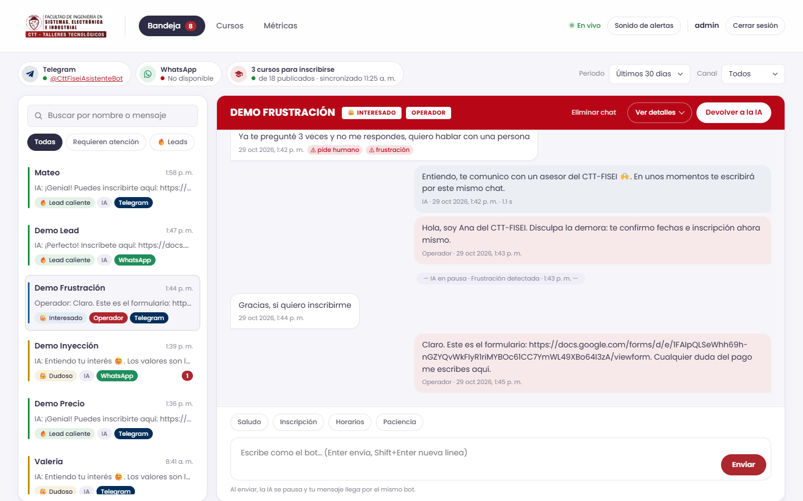
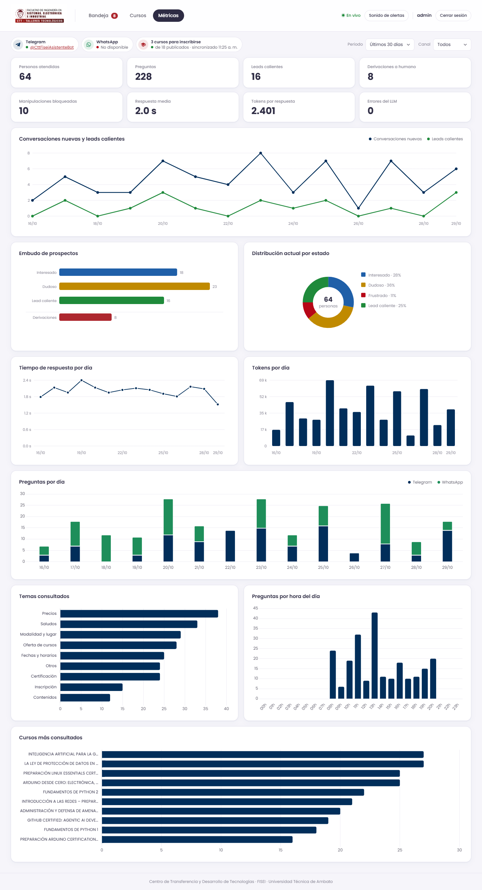
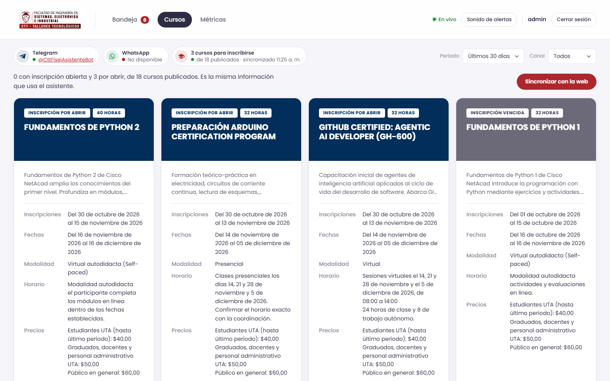
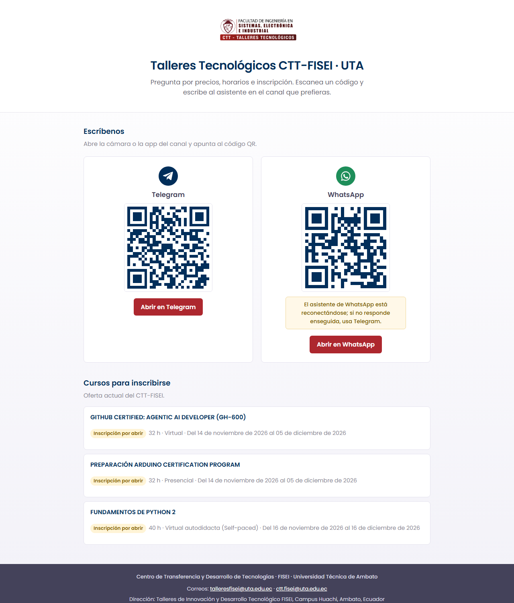
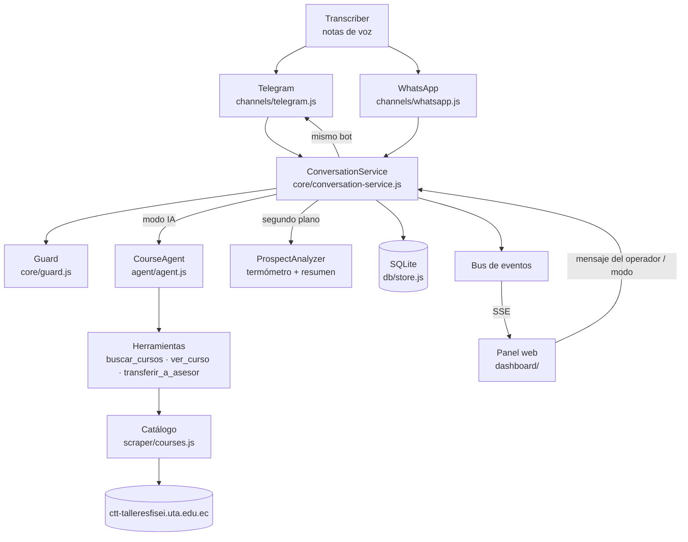

# 🎓 Asistente de Cursos CTT-FISEI

[](https://nodejs.org/)
[](https://developer.mozilla.org/docs/Web/JavaScript)
[](https://expressjs.com/)
[](https://nodejs.org/api/sqlite.html)
[](https://grammy.dev/)
[](https://wwebjs.dev/)
[](https://learn.microsoft.com/azure/app-service/)

**Asistente de Cursos CTT-FISEI** es un agente conversacional con IA que atiende por Telegram y WhatsApp a las personas interesadas en los cursos del Centro de Transferencia y Desarrollo de Tecnologías (CTT) de la FISEI. Informa, perfila al prospecto, responde objeciones, comparte el enlace de inscripción y, cuando hace falta, pasa la conversación a una persona. Incluye un panel de mando web en tiempo real para que el equipo del CTT supervise e intervenga.

Se construyó para el Reto Oficial Hackathon 2026 de la FISEI-UTA (*Ecosistema Multi-Agente para Ventas y Gestión Conversacional*), a partir de la oferta publicada en [ctt-talleresfisei.uta.edu.ec](https://ctt-talleresfisei.uta.edu.ec/course.php).

> [!TIP]
> Para verlo funcionando en local, sin claves, con datos de ejemplo:
> ```bash
> npm install && npm run seed && npm start
> ```
> Abre `http://localhost:3000`. Con `LLM_API_KEY` y `TELEGRAM_BOT_TOKEN` en `.env` el bot responde en Telegram.

---

## 📋 Descripción

### ¿Qué problema resuelve?

Los prospectos preguntan por los cursos a cualquier hora (madrugadas, fines de semana, feriados) y el equipo del CTT no alcanza a responder a tiempo. Un bot de menús rígido genera fricción y pierde inscripciones.

### ¿Qué hace?

1. Lee el catálogo de la web del CTT (nombre, estado, horas, precios, fechas, horario, requisitos, contenidos, instructores y enlace de inscripción) y lo refresca cada pocas horas.
2. Recibe mensajes de texto o notas de voz por Telegram y WhatsApp; las notas de voz se transcriben.
3. Revisa cada mensaje con barreras deterministas: intentos de inyección de prompt, pedidos de cursos gratis o descuentos, frustración y pedido de un humano.
4. Si la conversación está a cargo de la IA, el LLM responde como asesora académica: perfila, recomienda, argumenta el valor del curso y comparte el enlace de inscripción, consultando los datos con herramientas.
5. Valida la respuesta antes de enviarla (no promete descuentos ni filtra instrucciones).
6. En segundo plano clasifica al prospecto (*interesado*, *dudoso*, *frustrado* o *lead caliente*), detecta su perfil y escribe un resumen para el operador.
7. Ante frustración, pedido de humano o derivación del propio agente, la IA se pausa y el panel avisa al operador.
8. El operador responde desde el panel y su mensaje sale por el mismo bot; luego devuelve la conversación a la IA con un clic.

### ¿Para quién está pensado?

Para el personal de coordinación y ventas del CTT-FISEI, que necesita atender a muchos prospectos a la vez, y para los propios interesados, que reciben respuesta inmediata en el canal que ya usan.

---

## 📸 Capturas

| | |
| :---: | :---: |
|  |  |
| <sub>Bandeja en vivo: termómetro, modo IA/operador, resumen y respuesta del operador.</sub> | <sub>Métricas: leads, derivaciones, manipulaciones bloqueadas, temas y cursos.</sub> |
|  |  |
| <sub>Cursos: estado real de inscripción, fechas, precios y formulario.</sub> | <sub>Landing pública: QR de Telegram y WhatsApp y cursos vigentes.</sub> |

Las capturas se generaron con `npm run seed` (datos de ejemplo, sin personas reales).

---

## ✨ Características

- **Asesora con tono humano**: el prompt define a "Sofía", que conversa en mensajes cortos, recomienda uno o dos cursos según el perfil y explica su valor en lugar de listar el catálogo.
- **Perfilado y manejo de objeciones**: descubre si la persona es estudiante UTA, graduado o público general (define la tarifa) y responde a "es caro", "no tengo tiempo" o "no sé si tengo el nivel" con datos reales del curso.
- **Cierre de inscripción**: ante intención clara comparte el formulario de inscripción del curso y detecta inscripciones vencidas comparando con la fecha de hoy.
- **Formulario prellenado**: al compartir el enlace de inscripción, rellena en el Google Form los datos ya conocidos de esa conversación (nombre, tipo de participante y curso) para que la persona solo revise y envíe.
- **Aviso de espera**: con un operador a cargo, si nadie responde en `HOLD_OPERATOR_IDLE_MIN` minutos el bot confirma que el mensaje llegó (en español o inglés), sin repetirlo antes de `HOLD_COOLDOWN_MIN`.
- **Contención de inyecciones graves**: pedidos de revelar el prompt, modo DAN o falsa autoridad con descuentos reciben una respuesta fija sin pasar el texto al modelo; las cifras de la respuesta se validan contra los precios del catálogo.
- **Alertas y plantillas en el panel**: aviso sonoro (silenciable) cuando una conversación pasa a operador o se marca como urgente, plantillas rápidas para el operador y gráficas de tendencia de 14 días.
- **Handover transparente**: la IA se pausa sola ante frustración, pedido de humano o la herramienta `transferir_a_asesor`; el operador escribe desde el panel y el mensaje llega con la identidad del bot.
- **Reanudación automática**: si el operador no responde en `HANDOVER_TIMEOUT_MIN` minutos, la IA retoma la conversación.
- **Termómetro en tiempo real**: cada tarjeta muestra el estado del prospecto con icono, etiqueta y color, más el modo (IA u operador) y los mensajes sin leer.
- **Resumen automático para el operador**: el analizador resume qué busca la persona, sus objeciones y el siguiente paso.
- **Defensa contra prompt injection**: detección por patrones antes del LLM, nota de seguridad en el turno, reglas no negociables en el prompt y validación de la salida.
- **Inscripción real, no la etiqueta**: calcula si la inscripción sigue vigente con las fechas publicadas; no comparte enlaces de ediciones vencidas y recomienda una alternativa abierta.
- **Respaldo entre modelos**: si un modelo llega a su límite de tokens (429) la respuesta sigue con el siguiente de la lista.
- **Tolerancia a faltas ortográficas**: la búsqueda de cursos usa distancia de edición ("pyton", "arduno").
- **Notas de voz**: transcripción con cualquier endpoint compatible con `/audio/transcriptions` (por ejemplo Groq Whisper).
- **Identidad del CTT**: el panel usa el logo, la tipografía y los colores del sitio oficial; la cabecera de cada conversación es un póster de curso, marino cuando atiende la IA y carmesí cuando atiende un operador.
- **Landing pública de contacto**: `/contacto.html` muestra los QR de Telegram y WhatsApp (generados por el servidor con el bot y el número reales) y los cursos con inscripción vigente; no pide la contraseña del panel.
- **Pestaña Cursos**: el panel muestra el catálogo como pósters con el estado real de inscripción (abierta, por abrir, vencida o cerrada), fechas, modalidad, precios y el formulario; se puede sincronizar con la web en un clic.
- **Panel en tiempo real**: Server-Sent Events, sin recargar la página; API abierta a cualquier origen (CORS).
- **Métricas**: personas atendidas, leads calientes, derivaciones, manipulaciones bloqueadas, latencia, tokens por respuesta, temas, cursos y horarios.
- **Dos canales, un pipeline**: Telegram (grammY) y WhatsApp (whatsapp-web.js) usan el mismo servicio de conversación.
- **WhatsApp desde el panel**: el botón "Iniciar sesión" abre WhatsApp Web y muestra el QR en la tarjeta del canal; "Cerrar sesión" desvincula el teléfono. La sesión queda guardada y se reconecta sola al reiniciar.
- **Protocolo de riesgo**: si alguien menciona hacerse daño, el bot responde con contención y las líneas de ayuda de Ecuador (ECU 911, 171 opción 6), pausa la IA y marca la conversación como urgente para el operador.

---

## 🛠️ Tecnologías Utilizadas

- **Frontend**: HTML, CSS y JavaScript sin framework; Chart.js 4.4.1 desde cdnjs; `EventSource` para SSE. La identidad visual replica la del sitio del CTT: Poppins, rojo UTA `#AD272E`, pizarra `#44425A`, lila `#F2F1F8` y los pósters de curso en marino `#012E5A` y carmesí `#B70717`.
- **Backend**: Node.js (ESM), Express 5, grammY, whatsapp-web.js, SDK `openai` contra un proveedor compatible (por defecto Groq con `gpt-oss-120b`; también funciona con xAI), cheerio y undici para el scraping.
- **Base de datos**: SQLite con el módulo nativo `node:sqlite` (sin dependencias nativas).
- **Pruebas**: `node:test` y ESLint 10.
- **Despliegue**: Docker (Node 24 + Chromium) en Azure App Service con Azure Container Registry; también blueprint de Render y túnel de Cloudflare para demos locales.

---

## 🏗️ Arquitectura



Los conectores de mensajería solo traducen eventos del canal; toda la lógica de atención (handover, persistencia, análisis) vive en `ConversationService`, y el pipeline de inferencia (`CourseAgent`) no conoce la base de datos. El panel se entera de todo por el bus de eventos.

---

## 📁 Estructura del Proyecto

```bash
.
├── src/
│   ├── index.js                    # Punto de entrada: arranca catálogo, canales y panel
│   ├── config.js                   # Variables de entorno
│   ├── agent/
│   │   ├── agent.js                # Ciclo LLM + herramientas + validación de salida
│   │   ├── analyzer.js             # Termómetro, perfil y resumen del prospecto
│   │   ├── prompt.js               # Prompt de sistema y catálogo compacto
│   │   ├── tools.js                # buscar_cursos, ver_curso, transferir_a_asesor
│   │   ├── transcriber.js          # Transcripción de notas de voz
│   │   └── list-models.js          # Lista modelos del proveedor (npm run models)
│   ├── core/
│   │   ├── conversation-service.js # Orquestación, handover IA/humano
│   │   ├── guard.js                # Inyección, descuentos, frustración, salida segura
│   │   └── events.js               # Bus de eventos para SSE
│   ├── channels/
│   │   ├── telegram.js             # Conector grammY
│   │   ├── whatsapp.js             # Conector whatsapp-web.js
│   │   └── common.js               # Textos y utilidades compartidas
│   ├── db/
│   │   ├── store.js                # Esquema SQLite y migraciones
│   │   ├── analytics.js            # Consultas del panel
│   │   ├── topics.js               # Clasificación de temas por palabras clave
│   │   └── seed.js                 # Datos de ejemplo
│   ├── scraper/
│   │   ├── parse.js                # Parser del catálogo y del detalle de cursos
│   │   ├── courses.js              # Descarga, caché y refresco periódico
│   │   ├── run.js                  # npm run scrape
│   │   └── certs/                  # Certificado intermedio que la web de la UTA no envía
│   └── dashboard/
│       ├── server.js               # API REST + SSE + CORS + auth básica
│       └── public/                 # Panel (HTML, CSS, JS e img/logo-ctt.png)
├── data/courses.json               # Snapshot del catálogo (respaldo si la web no responde)
├── test/                           # Pruebas node:test y fixtures HTML
├── docs/capturas/                  # Capturas del panel
├── scripts/deploy-azure.sh         # Despliegue en Azure App Service
├── Dockerfile                      # Imagen con Node 24 y Chromium
├── render.yaml                     # Blueprint de Render
└── .env.example                    # Plantilla de variables de entorno
```

---

## 💻 Requisitos del Sistema

- Node.js 22.5 o superior (se probó con Node 26; la imagen Docker usa Node 24).
- npm 10 o superior.
- Una clave de un proveedor LLM compatible con la API de OpenAI (por defecto Groq, gratis en https://console.groq.com/keys).
- Un bot de Telegram creado con [@BotFather](https://t.me/BotFather).
- Solo para WhatsApp: Google Chrome o Chromium instalado y un teléfono para vincular la sesión.
- Solo en producción: un servicio siempre encendido con disco persistente (la base SQLite y la sesión de WhatsApp viven en disco).

---

## ⚙️ Instalación y Configuración

1. Clona el repositorio e instala dependencias:

```bash
git clone https://github.com/kiramman-mp3/ctt-fisei-agente.git
cd ctt-fisei-agente
npm install
```

2. Crea tu archivo de entorno a partir de la plantilla:

```bash
cp .env.example .env
```

3. Completa las variables en `.env`:

| Variable | Uso |
| :--- | :--- |
| `LLM_API_KEY` | Clave del proveedor LLM |
| `LLM_BASE_URL` | Endpoint compatible con OpenAI (por defecto `https://api.groq.com/openai/v1`) |
| `LLM_MODEL` | Modelos del agente separados por comas; ante un 429 se usa el siguiente (verifica con `npm run models`) |
| `LLM_ANALYZER_MODEL` | Modelos del termómetro y resúmenes (opcional) |
| `LLM_REASONING_EFFORT` | Esfuerzo de razonamiento para `gpt-oss` (`low` recomendado) |
| `TELEGRAM_BOT_TOKEN` | Token de @BotFather |
| `STT_API_KEY`, `STT_BASE_URL`, `STT_MODEL` | Transcripción de voz (opcional, por defecto Groq Whisper) |
| `WHATSAPP_ENABLED`, `CHROME_PATH`, `WWEBJS_DATA_PATH` | Conectar WhatsApp al arrancar, ejecutable de Chrome y carpeta de la sesión |
| `DASHBOARD_PORT`, `DASHBOARD_USER`, `DASHBOARD_PASSWORD` | Puerto y autenticación básica del panel (sin contraseña queda público) |
| `PUBLIC_WHATSAPP_NUMBER` | Número que muestra la landing `/contacto.html` aunque WhatsApp esté desconectado (opcional) |
| `HANDOVER_TIMEOUT_MIN` | Minutos sin respuesta del operador antes de que la IA retome (0 = nunca) |
| `HOLD_OPERATOR_IDLE_MIN`, `HOLD_COOLDOWN_MIN` | Aviso de espera en modo operador: minutos de inactividad (3) y separación mínima entre avisos (5) |
| `KEEPALIVE_URL` | URL opcional a la que se hace GET cada 10 minutos para que el host no se duerma |
| `DB_PATH`, `SQLITE_JOURNAL`, `COURSES_REFRESH_HOURS` | Ruta de SQLite, modo de diario (`WAL` por defecto, `DELETE` en discos de red) y frecuencia de refresco del catálogo |

> [!WARNING]
> Los secretos nunca se guardan en el repositorio: `.env` está en `.gitignore`. En producción se definen como variables de la plataforma.

4. Comprueba el modelo disponible y descarga el catálogo actualizado:

```bash
npm run models
npm run scrape
```

---

## 🚀 Uso y Ejecución

### Producción local

```bash
npm start
```

El panel queda en `http://localhost:3000` y el bot de Telegram empieza a responder. La landing pública de contacto con QR está en `http://localhost:3000/contacto.html`. Para WhatsApp pulsa **Iniciar sesión** en la tarjeta de WhatsApp del panel y escanea el QR desde WhatsApp > Dispositivos vinculados > Vincular un dispositivo. Con `WHATSAPP_ENABLED=true` (o con una sesión ya guardada) se conecta al arrancar.

### Desarrollo

```bash
npm run dev
```

Reinicia el proceso al guardar cambios. Para ver el panel con datos, ejecuta antes `npm run seed`.

| Script | Qué hace |
| :--- | :--- |
| `npm start` | Arranca catálogo, canales y panel |
| `npm run dev` | Igual que `start`, con recarga automática |
| `npm run scrape` | Descarga el catálogo y actualiza `data/courses.json` |
| `npm run models` | Lista los modelos del proveedor configurado |
| `npm run seed` | Crea 4 guiones `[demo]` + 60 conversaciones de ejemplo en la base configurada |
| `npm run eval` | Batería de evaluación del agente (PASS/FAIL; sale ≠0 si falla) |
| `npm run demo:check` | Chequeo previo a la demo: entorno, catálogo, health opcional y guiones |
| `npm run lint` | ESLint sobre todo el proyecto |
| `npm test` | Pruebas con `node:test` |
| `npm run check` | Lint y pruebas |
| `npm run tunnel` | Expone el panel local con un túnel de Cloudflare (requiere `cloudflared`) |
| `npm run deploy:azure` | Construye la imagen en Azure y publica la Web App |

### Antes de una demo

```bash
npm run demo:check
npm run seed
npm run eval
```

`demo:check` verifica `LLM_API_KEY`, el catálogo en `data/courses.json` (totales y ofertables) y, si defines `BASE_URL` (p. ej. `http://localhost:3000`), que `GET /api/status` responda. Lista los cuatro guiones etiquetados `[demo]` del seed: objeción de precio, inyección bloqueada, handover por frustración y lead caliente. `eval` ejercita el agente real (~18 casos de rúbrica + ataques) con chats aislados, imprime PASS/FAIL y limpia los datos de prueba.

### Comandos del bot

| Telegram | WhatsApp | Acción |
| :--- | :--- | :--- |
| `/start` | `menu`, `cursos` | Bienvenida y cursos abiertos |
| `/cursos` | `cursos` | Botones con los cursos abiertos |
| `/asesor` | "quiero hablar con un asesor" | Pausa la IA y avisa al operador |
| `/reiniciar` | `reiniciar` | Empieza una conversación nueva |

---

## ☁️ Despliegue

El bot usa *long polling*, así que el servicio debe estar siempre encendido; no sirve un entorno serverless que se duerme. Solo debe correr **una** instancia a la vez: dos procesos con el mismo token de Telegram se quitan los mensajes entre sí.

**Azure App Service (despliegue actual)**: con Azure CLI y sesión iniciada (`az login`), y un `.env` con `LLM_API_KEY` y `TELEGRAM_BOT_TOKEN`:

```bash
npm run deploy:azure
```

`scripts/deploy-azure.sh` crea (o reutiliza) el grupo `rg-ctt-fisei-agente` en `eastus2`, un Azure Container Registry Basic, un plan Linux B2 (2 núcleos; con B1 la CPU llega al 99 % al vincular WhatsApp y el teléfono cancela) y la Web App `ctt-fisei-asistente`. La imagen se construye con Docker local y se sube al registro (Azure for Students no permite `az acr build`), la app queda *Always On* y los secretos de `.env` pasan a la configuración de la app. Si `.env` no trae `DASHBOARD_PASSWORD`, se genera una. Volver a ejecutarlo publica la versión actual del código.

| Configuración en Azure | Por qué |
| :--- | :--- |
| `DB_PATH=/home/data/agente.db`, `SQLITE_JOURNAL=DELETE` | `/home` es persistente pero es un disco de red, donde WAL no es seguro |
| `WWEBJS_DATA_PATH=/tmp/wwebjs` | Chrome no puede guardar su perfil en `/home`; tras cada reinicio hay que volver a escanear el QR de WhatsApp |
| `WEBSITES_PORT=3000` | Puerto del contenedor |

**Render**: crea un *Blueprint* apuntando a este repositorio. `render.yaml` define un servicio Docker con disco persistente en `/app/storage` (SQLite y sesión de WhatsApp) y health check en `/api/status`. Define en Render: `LLM_API_KEY`, `TELEGRAM_BOT_TOKEN`, `DASHBOARD_PASSWORD` y, si usas voz, `STT_API_KEY`. La plataforma inyecta `PORT` y la aplicación lo respeta.

**Cualquier host con Docker**:

```bash
docker build -t ctt-fisei-agente .
docker run -d -p 3000:3000 --env-file .env -v ctt-data:/app/storage ctt-fisei-agente
```

**Demo desde una laptop**: `npm start` y en otra terminal `npm run tunnel`; Cloudflare devuelve una URL pública `https://*.trycloudflare.com` para el panel. Antes de enseñarlo, corre `npm run demo:check` (con `BASE_URL` apuntando al panel si ya está arriba) y, si quieres datos en la bandeja, `npm run seed`.

---

## 🔧 Detalles Técnicos

### API del panel

| Método | Ruta | Descripción |
| :--- | :--- | :--- |
| `GET` | `/api/events` | Stream SSE: `message`, `conversation`, `status` |
| `GET` | `/api/inbox?range=&channel=` | Conversaciones con estado, modo, resumen y último mensaje |
| `GET` | `/api/conversations/:userId` | Conversación y mensajes (con eventos de handover intercalados) |
| `POST` | `/api/conversations/:userId/messages` | Mensaje del operador `{ text }`: pausa la IA y lo envía por el bot |
| `POST` | `/api/conversations/:userId/mode` | `{ mode: "ai" \| "human" }`: tomar control o devolver a la IA |
| `POST` | `/api/conversations/:userId/read` | Marca la conversación como leída |
| `GET` | `/api/overview?range=&channel=` | Métricas agregadas |
| `GET` | `/api/analytics/timeseries?range=&channel=` | Series de 14 días, embudo y distribución para las gráficas |
| `GET` | `/api/public/contact` | Público: bot de Telegram, número de WhatsApp y sus QR para la landing |
| `GET` | `/api/public/courses` | Público: cursos con inscripción abierta o por abrir |
| `GET` | `/api/courses` | Catálogo con estado real de inscripción, ordenado por disponibilidad |
| `GET` | `/api/status` | Estado de Telegram, WhatsApp (incluye QR) y catálogo |
| `POST` | `/api/whatsapp/start` | Abre WhatsApp Web y publica el QR por SSE |
| `POST` | `/api/whatsapp/logout` | Desvincula el teléfono y borra la sesión |
| `POST` | `/api/courses/refresh` | Fuerza el refresco del catálogo |

Todas las rutas responden con CORS abierto. Si hay `DASHBOARD_PASSWORD`, piden autenticación básica, salvo `/contacto.html`, sus archivos, `/img/` y `/api/public/*`.

### Reglas de handover

| Disparador | Qué pasa |
| :--- | :--- |
| Mensaje con posible riesgo para la persona (autolesión) | Respuesta de contención con líneas de ayuda, IA en pausa, aviso URGENTE |
| El usuario pide una persona (`/asesor`, "quiero hablar con un humano") | Respuesta de traspaso, IA en pausa |
| Frustración detectada por patrones | Respuesta de traspaso, estado `frustrado`, IA en pausa |
| El analizador clasifica `frustrado` | IA en pausa para el siguiente mensaje |
| El agente llama a `transferir_a_asesor` (becas, descuentos, convenios, reclamos, dudas académicas) | Responde y queda en pausa |
| El operador escribe o pulsa "Tomar control" | IA en pausa |
| El operador pulsa "Devolver a la IA" o no responde en `HANDOVER_TIMEOUT_MIN` | La IA retoma |

### Seguridad frente a prompt injection

- `guard.inspectInput` marca `inyeccion`, `descuento_indebido`, `pide_humano`, `frustracion` (incluye insultos) y `riesgo` antes de llamar al LLM; los intentos quedan registrados como eventos y se ven en el panel.
- Cuando hay bandera, el turno del usuario lleva una nota del sistema que el modelo debe respetar.
- El prompt fija las reglas de seguridad como prioridad máxima: no hay cursos gratis, cupones ni descuentos fuera de las tarifas publicadas.
- `guard.checkOutput` bloquea respuestas que prometan descuentos, cupones o revelen instrucciones, y las reemplaza por una respuesta segura.

### Gestión de tokens y contexto

- El prompt lleva un catálogo de una línea por curso; el detalle completo se pide con `ver_curso` solo cuando hace falta.
- El historial se limita a los últimos 10 mensajes y a 6000 caracteres; lo anterior se resume con el analizador y entra como contexto.
- Los mensajes del usuario se recortan a 1500 caracteres; el historial, el resumen y el perfil comparten un tope de 6000 caracteres, y las respuestas un máximo de 1200 tokens (incluye el razonamiento de `gpt-oss`).
- El análisis del prospecto corre después de responder, así que no suma latencia.
- Cada respuesta guarda latencia y tokens; el panel muestra el promedio de tokens por respuesta.

### Catálogo de cursos

El scraper lee `course.php` y cada `cursoN.php`. Las tarjetas comentadas en el HTML no se publican, por eso se ignoran. El servidor de la UTA no envía el certificado intermedio de Sectigo, así que se incluye en `src/scraper/certs/`. Si la web no responde, se usa `data/courses.json`.

### Pendiente de confirmar

- El plan gratis de Groq limita a 8000 tokens por minuto por modelo; por eso `LLM_MODEL` encadena tres modelos. Con muchas personas a la vez conviene el plan Dev de Groq.
- La web del CTT muestra dos direcciones distintas (Río Payamino y Río Guayllabamba); el agente solo menciona "FISEI, Campus Huachi, Av. Los Chasquis".
- Varios cursos figuran como "ABIERTO" en la web aunque su inscripción ya venció; el estado real se calcula con las fechas (`registrationStatus`) y el bot solo ofrece inscripción en los vigentes.

---

## 🗺️ Roadmap de Funcionalidades

- [x] Scraper del catálogo con caché y refresco periódico
- [x] Agente LLM con herramientas y prompt de ventas
- [x] Canal de Telegram y canal de WhatsApp
- [x] Handover IA/operador con reanudación automática
- [x] Termómetro, perfil y resumen del prospecto
- [x] Panel en tiempo real con SSE y métricas
- [x] Defensa contra prompt injection y validación de salida
- [x] Transcripción de notas de voz
- [x] Docker y blueprint de Render
- [x] Despliegue en Azure App Service
- [x] Vinculación de WhatsApp con QR desde el panel
- [x] Protocolo de contención ante riesgo para la persona
- [ ] Varios operadores con asignación de conversaciones
- [ ] Notificaciones push al operador cuando la IA se pausa
- [x] Evaluaciones automáticas de calidad de respuestas (`npm run eval`) y chequeo previo a la demo (`npm run demo:check`)

---

## 👥 Contribuidores

| Nombre | Commits |
| :--- | :---: |
| kiramman-mp3 | 122 |
| Dayle Garcia | 7 |

---

<details>
<summary>📚 Fuentes y referencias</summary>

- Oferta de cursos: https://ctt-talleresfisei.uta.edu.ec/course.php
- grammY: https://grammy.dev/
- whatsapp-web.js: https://wwebjs.dev/
- API de Groq: https://console.groq.com/docs
- API de xAI: https://docs.x.ai/
- `node:sqlite`: https://nodejs.org/api/sqlite.html
- Render Blueprints: https://render.com/docs/blueprint-spec

</details>

---

## ✍️ Autor

kiramman-mp3
